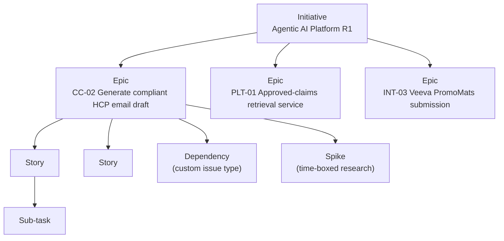

# Jira & Confluence Structure

> Fictional portfolio sample. This is the tooling design I'd stand up in the first week, before any stories are written.

## Design principles

1. **One program, one Jira project.** Modules are separated by *component*, not by project, so cross-module dependencies and platform reporting stay in one place.
2. **Every cross-team handoff is a ticket.** Dependencies are Jira issues with an owner and due date, not side conversations.
3. **Confluence holds decisions, Jira holds work.** Every Jira epic links to its spec page, and every decision has a log entry.

## Jira

### Project
- **Key:** `ACP` (Agentic Content Platform), Scrum template
- **Components:** `Content Composer` · `Platform: Retrieval` · `Platform: Guardrails` · `Platform: Audit` · `Integration: Workfront` · `Integration: AEM Assets` · `Integration: Veeva PromoMats` · `Integration: AJO`
- **Team field:** `Mktg` · `DSML` · `DT` · `Compliance` (drives per-team boards and dependency reports)

### Issue hierarchy



| Issue type | Used for | Owner |
|---|---|---|
| Initiative | Program-level outcome (R1) | PO + TPM |
| Epic | A releasable capability | PO |
| Story | User-facing increment with acceptance criteria | BA writes, team estimates |
| Spike | Time-boxed research (e.g. Veeva API limits) | Assigned engineer |
| Dependency | A deliverable one team needs from another | Delivering team |
| Bug / Task / Sub-task | Standard | Team |

> **Tooling note:** an *Initiative* level above epics needs Jira Premium/Enterprise (the **Plans** feature, formerly Advanced Roadmaps). On Jira Standard I'd use a label or a parent epic per release instead, and do roll-up reporting from a dashboard.

### Tracking dependencies: two options

| Option | How | When I'd pick it |
|---|---|---|
| **A. Issue links** (`is blocked by` / `blocks`) shown in Plans' dependency view | Link the consuming story directly to the delivering team's story | Teams share one Jira instance and plan in Plans; lightweight |
| **B. A `Dependency` issue type** (used here) | One ticket per cross-team deliverable, with *Needed by* and *Committed* dates, linked to stories on both sides | Teams are in different Jira projects or instances (common between US and Global teams), or a deliverable isn't a single story. It gives one board to review in the weekly sync |

**Chosen: B**, because DT Global runs its own Jira project. Option A links are still added, so Plans can draw the dependency lines.

### Workflow

`Backlog → Refinement → Ready → In Progress → In Review → In Test → Done`, plus a **`Blocked`** status that requires a *Blocked reason* and a linked issue.

### Definition of Ready (story can enter a sprint when…)
- [ ] User story written as *As a / I want / so that*
- [ ] Given/When/Then acceptance criteria, including at least one negative path
- [ ] For AI behavior: evaluation metrics and thresholds stated (see *Two kinds of acceptance criteria* in `04-requirements`)
- [ ] Dependencies identified and linked (Dependency issues have a committed date)
- [ ] Compliance has reviewed any criteria touching claims, references or guardrails
- [ ] Estimated by the team; fits in one sprint

### Definition of Done
- [ ] All acceptance criteria pass in the test environment
- [ ] For AI behavior: evaluation **and** red-team results attached (model version, prompt version, test set version, score per metric vs. threshold)
- [ ] For AI behavior: no metric regressed vs. production (release gate, CC-02-11)
- [ ] The agent's tool permissions are unchanged, or a change is approved by DT Security
- [ ] Audit log entries verified for any generation flow touched
- [ ] Confluence spec page updated; release note drafted

### Custom fields & labels
| Field | Purpose |
|---|---|
| `Team` | Which team owns the work (Mktg / DSML / DT / Compliance) |
| `Needed by` (date) | On Dependency issues: when the *consuming* team needs it |
| `HITL checkpoint` (Y/N) | Flags stories that change a human review point. These need Compliance sign-off |
| `RAID ID` | Links a ticket to its RAID log entry |
| Labels: `ai-behavior`, `guardrail`, `regulatory`, `global-reuse` | Filters for evaluation, compliance and reuse reporting |

### Boards & dashboards
- **Delivery board** (Scrum, per sprint)
- **Program dependency board:** Kanban of all `Dependency` issues, swimlanes by delivering team, sorted by `Needed by`
- **Steering dashboard:** epic progress, burnup to milestone, open Blocked items older than 5 days, RAID high-severity count

## Confluence space tree (`ACP`)

```
Agentic Content Platform (home: vision, team directory, links)
├── 00 Program Management
│   ├── Program Charter
│   ├── Roadmap & Milestones
│   ├── RAID Log (Jira-backed)
│   ├── Weekly Status Reports
│   ├── Decision Log
│   └── Steering Committee (agenda + minutes per meeting)
├── 10 Product & Requirements
│   ├── Business Requirements (BRD)
│   ├── Epic specs (one page per epic, linked to Jira)
│   ├── As-is / To-be Process Maps
│   └── Glossary (MLR, claim, reference, HITL…)
├── 20 AI / DSML
│   ├── Agent Functional Specs
│   ├── Prompt Library & Versioning
│   ├── Evaluation & Red-Team Sets (versioned)
│   ├── Evaluation Results & Release Gate Log
│   └── Model Card
├── 30 Integrations & Architecture
│   ├── Workfront · AEM Assets · Veeva PromoMats · AJO
│   └── Security & Privacy Reviews
├── 40 Compliance
│   └── Guardrail Rules (owned by MLR/Compliance)
└── 90 Global Alignment
    ├── Global Standards & Reuse Register
    └── Cross-Region Meeting Notes
```

## Ceremonies across time zones

US Pacific (PT) and Central European Time (CET) are 9 hours apart. The shared live window is about **08:00–09:00 PT = 17:00–18:00 CET**.

| Ceremony | When | Mode |
|---|---|---|
| Daily stand-up | 08:00 PT / 17:00 CET, 15 min | Live. US mid-morning items go async in a Slack thread |
| Weekly program sync | Tue 08:00 PT, 45 min | Live. Agenda and RAID pre-read posted Monday |
| Backlog refinement | Wed 08:00 PT, 60 min | Live. Stories posted 24h ahead for async comments |
| Sprint review / planning | Every 2nd Thu, 07:30–09:00 PT | Live |
| Weekly status report | Fri, by 12:00 PT | Async (Confluence + email) |
| Decisions outside the window | Anytime | Async: Decision Log page with a 24h comment window before closing |
