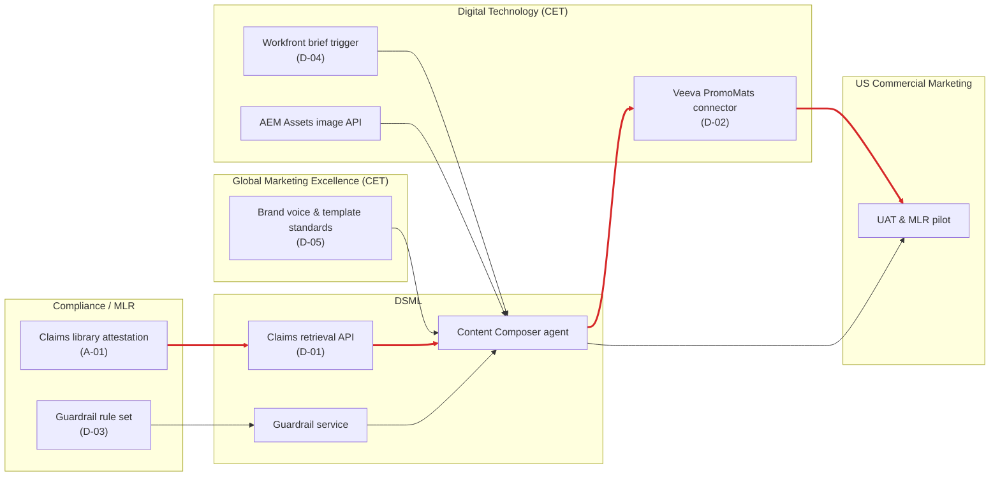
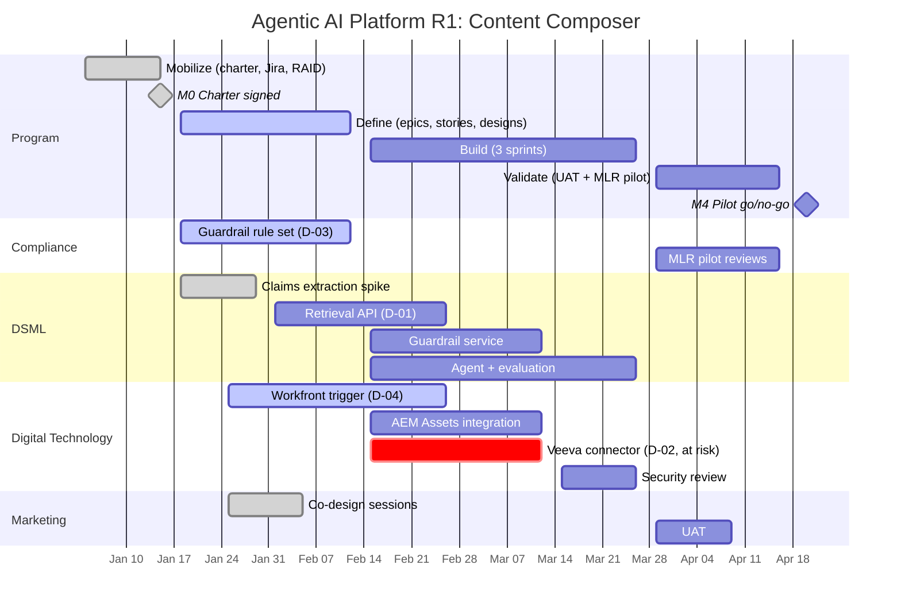

# Cross-Team Dependency Map & Roadmap

> IDs match the [RAID log](../02-tracking/raid-log.csv).

## 1. Who needs what from whom

Arrows point from the **delivering** team to the **consuming** team. Red = critical path.

**Critical path:** claims retrieval → Composer agent → Veeva connector → UAT/MLR pilot. The Veeva connector (D-02) is the least certain link, because there's no sandbox yet (R-04). That's why it leads the status report.

## 2. Dependency register

| ID | Deliverable | From → To | Needed by | Committed | Status | Fallback if late |
|---|---|---|---|---|---|---|
| D-01 | Claims retrieval API (claim + reference IDs) | DSML → Composer | 2027-02-26 | 2027-02-26 | 🟢 On track | Composer builds against mock endpoint |
| D-02 | Veeva PromoMats submission connector | DT → Composer | 2027-03-12 | TBD | 🔴 At risk | Manual PDF package upload for pilot (adds ~30 min per asset) |
| D-03 | Approved guardrail rule set | Compliance → DSML | 2027-02-12 | 2027-02-11 | 🟢 On track | Verbatim-claims-only mode, which needs fewer rules |
| D-04 | Workfront brief form + webhook | DT → Mktg/Composer | 2027-02-26 | 2027-02-24 | 🟢 On track | Brief entered directly in Composer UI |
| D-05 | Brand standards in usable format | Global → DSML | 2027-02-05 | 2027-02-05 | ✅ Done | n/a |

**How I run it:** each row is a `Dependency` issue in Jira. The consuming team sets *Needed by* and the delivering team sets *Committed*. Any gap between those two dates is discussed in the weekly program sync. A dependency with no committed date after 5 business days goes to the Steering Committee.

## 3. Release 1 roadmap

