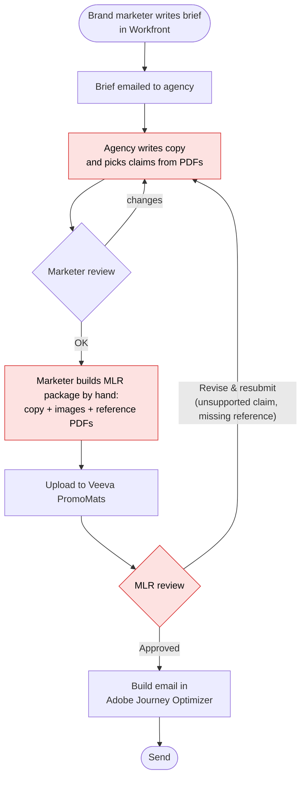
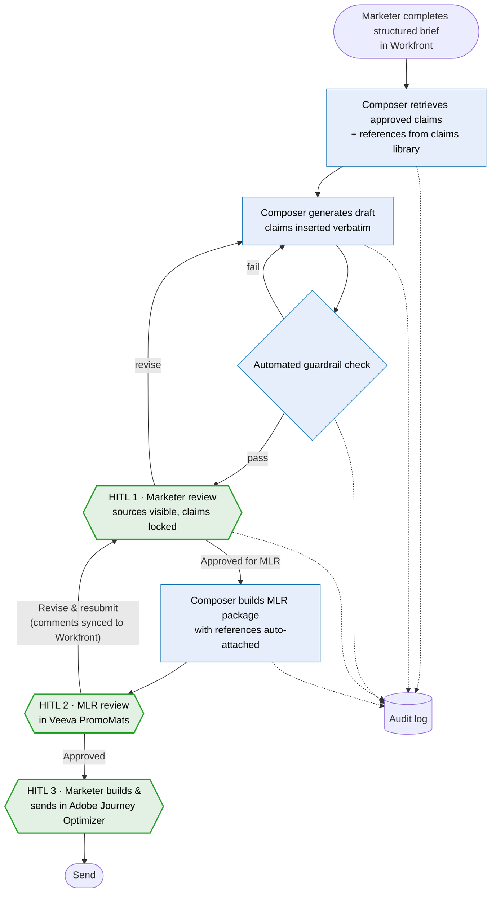

# As-Is / To-Be: Promotional Content Workflow

> Fictional portfolio sample. Shows the current process for one HCP email, the future process with Content Composer, and exactly where humans stay in control.

## 1. As-is (today)

### Pain points (red boxes)

| # | Where | Pain point | Effect |
|---|---|---|---|
| P1 | Agency copywriting | Claims copied from PDFs by hand; wording drifts from approved text | Main driver of MLR rejections |
| P2 | Agency loop | Multiple brief → draft → feedback rounds over email | Days lost per round; agency cost |
| P3 | MLR package | References attached by hand; easy to miss one | Rejections for "missing reference" |
| P4 | MLR loop | Rejections send the asset back to the start | Cycle time multiplies with each loop |
| P5 | Two systems | MLR status lives in Veeva, task status in Workfront | Marketers chase status manually |

## 2. To-be (with Content Composer)

Blue = AI/automated step · Green = human-in-the-loop checkpoint · Dotted = written to the audit log

## 3. Human-in-the-loop checkpoints

| Checkpoint | Who | What they decide | What the system guarantees | Story |
|---|---|---|---|---|
| **HITL 1** · Marketer review | Brief owner | Is this draft good enough to send to MLR? | Can't be skipped. Claims locked. Sources visible. Edits re-checked by guardrails | CC-02-06, CC-02-08 |
| **HITL 2** · MLR review | Medical, Legal, Regulatory reviewers | Is this compliant to use? | Unchanged from today. Composer only improves the package quality | CC-02-08, CC-02-09 |
| **HITL 3** · Build & send | Marketer | Final send | No automatic publishing in R1. Approved drafts are locked from AI edits | CC-02-09 |

**Design rule:** the AI can *propose* and *check*, but only a named human can *approve* or *publish*. The automated guardrail check is a filter. It never replaces HITL 2.

## 4. How the pain points are addressed

| Pain point | To-be change | Measured by (charter objective) |
|---|---|---|
| P1 Claim wording drift | Verbatim claims from the library + guardrail check | O2: fewer claim-related MLR rejections |
| P2 Agency loops | In-tool revision with feedback (minutes, not days) | O1: brief-to-submission time |
| P3 Missing references | References attached automatically from claim IDs | O2 |
| P4 Full restarts after rejection | MLR comments return to the same draft, not to a new agency round | O1 |
| P5 Two systems | MLR status synced into Workfront | Adoption feedback (pilot survey) |
