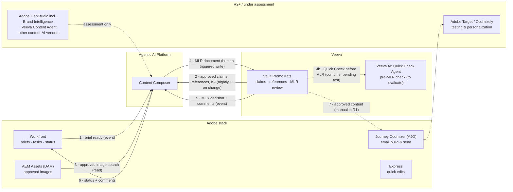
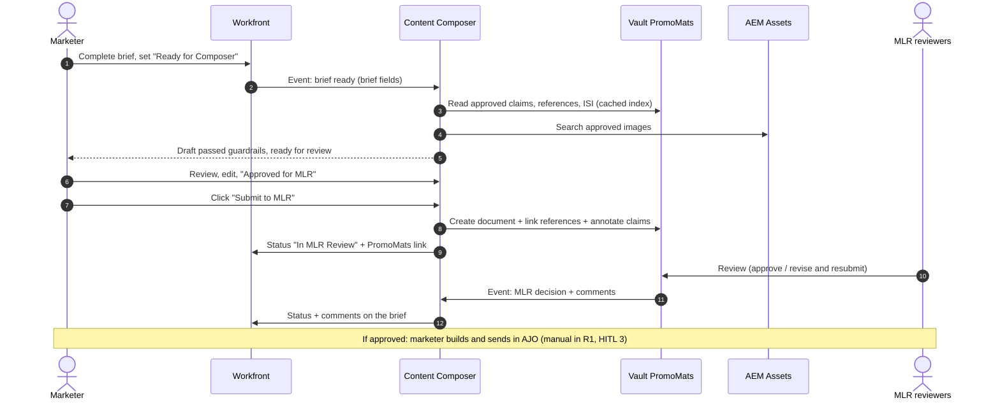

# Content Stack Integration Map: Adobe + Veeva

> Fictional portfolio sample. It maps the functional requirements onto the systems Content Composer has to work with. The Adobe and Veeva product names are real. The field names, lifecycle states and configuration shown here are **illustrative**: every company configures Workfront and Vault differently, so each mapping below is confirmed with the system owners in a spike before build.

## 1. System landscape

Solid lines = built in R1 · Dotted = manual in R1, later release, or assessment

## 2. End-to-end sequence (one HCP email)

## 3. System-to-requirement matrix

| System | Role in R1 | Data exchanged | Direction | Mechanism (to confirm in spike) | System owner | Stories | Release |
|---|---|---|---|---|---|---|---|
| **Adobe Workfront** | Brief intake, task status | Brief fields; status; MLR comments | ⇄ | Custom form on the brief + event subscription → Composer; Workfront API for status updates. **Alternative to test:** Workfront's MCP integration (announced 2026) | Marketing Ops / DT | CC-02-01, CC-02-09 | R1 |
| **Veeva Vault PromoMats** (claims) | Source of approved claims, references, ISI | Claim text, IDs, status, expiry, linked references | → Composer | Vault REST API, nightly export + on-change trigger into the retrieval index | Compliance / DT | CC-02-02 | R1 |
| **Veeva Vault PromoMats** (MLR) | MLR review system of record | Draft document, reference links, claim annotations; MLR decision and comments | ⇄ | Vault REST API (create document, relationships, annotations); event/webhook or polling for decisions | Compliance / DT | CC-02-08, CC-02-09 | R1 |
| **Veeva AI for PromoMats** (Quick Check Agent) | Second compliance check on the submitted document, before human MLR review | Check results on the PromoMats document | Inside Vault | Native Vault feature; no Composer integration needed beyond reading results into the audit trail | Compliance / DT | CC-02-08 | R1 candidate (pending test, open question 6 in the agent spec) |
| **AEM Assets** | Approved images | Asset ID, rendition, brand tags, approval status, rights expiry | → Composer | AEM Assets API search with metadata filters | DAM team / DT | CC-02-04 | R1 |
| **Adobe Journey Optimizer** | Email build and send | MLR-approved copy and images | PromoMats → AJO | **Manual in R1** (HITL 3). Automated hand-off is an R2 candidate | Marketing Ops | — | R2 |
| **Adobe Express** | Quick image edits by marketers | Edited image → back to AEM for approval | — | Out of scope; edited assets must go back through DAM approval | DAM team | — | — |
| **Adobe Target / Optimizely** | Testing variants of approved content | Approved variants, results | — | Out of scope for R1. Each variant still needs MLR approval | Marketing Analytics | — | R2+ |
| **Adobe GenStudio** (incl. Brand Intelligence), **Veeva Content Agent**, other content-AI vendors | Possible build-vs-buy or complement for drafting and brand voice | — | — | Feasibility assessment (Tier 3 artifact); see *Build, buy or combine* in the agent spec | Program / DT | — | Assessment |

## 4. Data mappings

### Brief → draft request (Workfront custom form)

| Workfront field (illustrative) | Composer field | Validation |
|---|---|---|
| Brand (dropdown) | `brand` | Must have an active claims library |
| Audience (dropdown) | `audience` | R1: HCP |
| Channel (dropdown) | `channel` | Email / web banner |
| Key message (text) | `key_message` | ≤ 500 chars, PII check |
| Call to action (text) | `call_to_action` | ≤ 100 chars |
| Planned in-market date | `planned_send_date` | Must be in the future |
| Task owner | `owner_user_id` | Must map to an SSO user |

### Status sync: PromoMats lifecycle ↔ Workfront

Example states only. The real lifecycle comes from the company's Vault configuration.

| PromoMats state (example) | Workfront task status | Composer draft state | Who acts next |
|---|---|---|---|
| Draft (created by Composer) | In MLR Review | Submitted | MLR coordinator |
| In MLR Review | In MLR Review | Submitted | Reviewers |
| Revise and Resubmit | MLR Changes Requested (+ comments) | Reopened for revision | Marketer |
| Approved for Distribution | MLR Approved | Locked | Marketer builds in AJO |
| Withdrawn / Expired | Cancelled / Expired | Archived | — |

## 5. Integration requirements (all interfaces)

| Area | Requirement |
|---|---|
| Authentication | Service accounts with least privilege per system. Composer's PromoMats account can create documents but **can't approve** them |
| Traceability | Every outbound write carries `draft_id` and `trace_id`, and stores the target system's record ID back on the audit record |
| Idempotency | Writes keyed on `draft_id + version`, so a retry never creates a duplicate PromoMats document |
| Retries | Exponential backoff, at most 3 retries, then queued with an alert to DT support |
| Rate limits | Stay within each vendor's API limits (unknown for PromoMats, RAID R-04). Nightly claims sync runs off-peak |
| Environments | Each integration tested in a sandbox before production. **No PromoMats sandbox yet** is the program's top risk (R-04 / D-02) |
| Monitoring | Integration failures appear on the steering dashboard. More than 5 failures in an hour pages DT support |

## 6. Spikes before build

| Spike | Question | Owner | RAID / Jira |
|---|---|---|---|
| S-1 | Vault API: create a document with reference relationships and claim annotations. What's possible in Aurelis' configuration? | DT | R-04 · ACP-22 |
| S-2 | Claims export: can claims + references + expiry come out in structured form, or do we parse documents? | DSML + Compliance | R-01 · ACP-14 |
| S-3 | Workfront: event subscription on a custom-form status change vs. Workfront's MCP integration. Latency, payload, and which one needs less custom code? | DT | A-03 · ACP-18 |
| S-4 | AEM Assets: is rights-expiry metadata searchable, and how complete is it for the pilot brand? | DT + DAM team | I-03 · ACP-27 |
| S-5 | Veeva AI: run Quick Check on 10 historical assets alongside Composer's guardrails. Where do they agree and where do they differ? | Compliance + DSML | R-10 |

> Vendor AI capabilities named here come from vendor materials and press coverage as of late 2026. Each one is confirmed in a demo or sandbox, and against what Aurelis has licensed, before any design depends on it.
