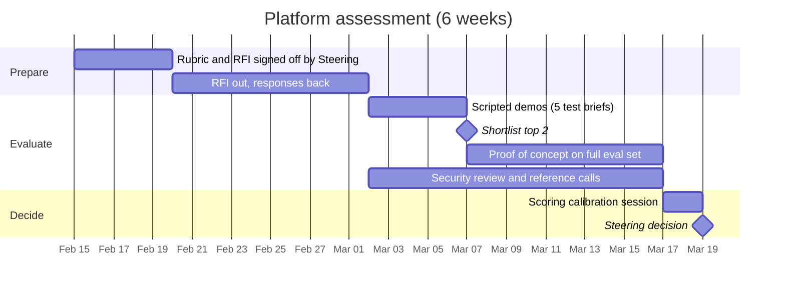

# Content-AI Platform Assessment: Build, Buy or Combine

> Fictional portfolio sample. It shows **how I'd run** a platform assessment, not a verdict on any real product. Vendor capabilities in section 3 are summarized from public vendor materials and press coverage as of late 2026 (sources at the end), and every one has to be verified in demos and a proof of concept. **No real product is scored here.** The worked scoring example in section 6 uses anonymous options with made-up numbers to show the method.

| Field | Value |
|---|---|
| Decision to support | Which capabilities of the Agentic AI Platform Aurelis builds, buys, or gets from tools it already licenses, for Release 2 and beyond |
| Decision forum | Steering Committee, with recommendation from TPM/BA + DSML + DT + Compliance |
| Feeds from | [Agent spec §11 Build, buy or combine](../06-agent-spec/agent-functional-spec.md) · RAID R-10 |
| Timebox | 6 weeks, running in parallel with R1 Build |

## 1. The question

R1 builds Content Composer in-house to prove the approach on one brand. Before scaling to more brands, channels and markets, Aurelis needs to decide which layers to own and which to take from vendors. The decision is made **per capability**, not as one platform-wide choice:

| Capability layer | Question |
|---|---|
| A. Draft generation | Who writes the first draft? |
| B. Brand voice & brand rules | Where do brand rules live, so there's one source of truth? |
| C. Claims & references | Who decides which approved claims go in, and guarantees exact wording? |
| D. Pre-MLR compliance check | What checks content before human MLR review? |
| E. Workflow orchestration | What moves work between Workfront, AEM, PromoMats and AJO? |
| F. Evaluation & audit | Who proves the AI is working and keeps the record? |

## 2. Options in scope

| # | Option | Type | Layers it could cover |
|---|---|---|---|
| 1 | **Build:** extend Content Composer (R1) | In-house | A–F |
| 2 | **Adobe GenStudio for Performance Marketing** (incl. Brand Intelligence) | Adobe stack | A, B, D (brand checks) |
| 3 | **Adobe CX Enterprise Coworker** | Adobe stack | E |
| 4 | **Veeva AI for PromoMats** (Quick Check Agent, Content Agent; claims agent announced) | Veeva stack | C (announced), D, A |
| 5 | **Specialist life-sciences content-AI vendors** | Third party | Shortlist of 2–3 from an RFI |
| 6 | **Hybrid:** the best layer from each of the above | Mix | A–F |

## 3. What's publicly known (to verify)

| Option | Publicly stated capabilities relevant here | Gaps / open questions for the RFI |
|---|---|---|
| **Adobe GenStudio for Performance Marketing** | Generates on-brand ads and emails; checks content for brand voice, accessibility and regulatory standards before it goes live; can import pre-approved elements like disclaimers and citations; approvals built in or through Workfront; integrates with AEM, Workfront, Express. Brand Intelligence was added in April 2026 to keep content on brand | **No Veeva PromoMats integration found in public materials.** How do claims stay word-for-word? Can "regulatory standards" checks be configured to Aurelis' MLR rules? Where are approved claims stored? |
| **Adobe CX Enterprise Coworker** | Launched April 2026. A set of AI agents that coordinate customer-experience workflows across Adobe and third-party systems: campaign creation, engagement optimization, marketing operations. Available standalone or as an add-on; runs on Adobe Experience Platform | Can it orchestrate a PromoMats step with a human approval gate? What controls agent permissions? What's in the audit trail? |
| **Veeva AI for PromoMats** | Quick Check Agent and Content Agent in PromoMats starting with the 25R3 release; Quick Check reviews content against editorial, brand, market, channel and compliance guidelines before MLR. A claims management agent was announced, and custom agents are listed for August 2026 | Content Agent's output quality for HCP email? Does it generate inside Vault only, or work with AEM/AJO? Timeline for the claims agent? |
| **Build (Composer)** | Proven in R1 for one brand: claim slots (exact wording), evaluation gate, cross-system audit | Cost to scale; competing with vendor roadmaps; DSML capacity |
| **Specialist vendors** | Not assessed yet | RFI to identify a shortlist |

## 4. Scoring rubric

### Step 1: Knock-out criteria (pass/fail before any scoring)

Any option that fails one of these drops out, however well it scores elsewhere.

| # | Knock-out | Why |
|---|---|---|
| K1 | Human approval required before anything is published; no automatic publishing | O3 hard gate in the charter |
| K2 | Customer content not used to train the vendor's models | Data protection, confidential brand plans |
| K3 | SSO and role-based access | Security baseline |
| K4 | Exportable, tamper-proof audit log of AI actions | Audit trail (CC-02-10), Part 11 expectations |
| K5 | Approved claims can be reproduced **word for word**, provably | Core reason for MLR rejections (O2) |
| K6 | Passes Aurelis' security and privacy review | Required for any production system |
| K7 | Vendor **names the AI models** its product uses, gives **advance notice of model changes**, and lets Aurelis re-run its own evaluation set before a change reaches production | Otherwise a silent model swap bypasses the release gate (CC-02-11, RAID R-09) |

### Step 2: Weighted criteria

Each criterion is scored **1–5** using the anchors below. Weights add up to 100.

| # | Criterion | Weight | 1 = | 3 = | 5 = |
|---|---|---|---|---|---|
| C1 | **Regulatory fit:** claims, references, ISI, MLR hand-off | 25 | Manual workaround needed | Supported with custom work | Native, configurable, demonstrated with our claims |
| C2 | **Content quality & brand control** | 15 | Below R1 Composer on the eval set | Matches R1 Composer | Beats R1 Composer on the eval set |
| C3 | **Integration with our stack** (Workfront, AEM, PromoMats, AJO) | 15 | Point-to-point custom build | APIs available, some custom work | Native connectors, incl. PromoMats |
| C4 | **Auditability & evaluation transparency** | 10 | Black box | Logs available, limited metrics | Full trace + we can run our own eval set |
| C5 | **Security, privacy & responsible-AI evidence** | 10 | Meets minimum only | Meets all requirements; SOC 2 | Exceeds them: ISO/IEC 42001 certified, publishes its own evaluation and red-team results |
| C6 | **Extensibility & open standards** (custom agents, APIs, model choice, **MCP**, agent-to-agent protocols such as **A2A**) | 6 | Closed | Some configuration, proprietary connectors | Open: our own agents, tools and rules over open protocols |
| C7 | **Global reuse & localization** | 6 | US/English only | Some markets | Multi-market, multi-language with local rules |
| C8 | **Total cost of ownership** (3 years, incl. internal effort and **usage-based pricing scenarios**) | 5 | Highest, or cost unpredictable at high usage | Middle | Lowest and predictable across scenarios |
| C9 | **Vendor viability & roadmap fit** | 4 | Roadmap unclear | Roadmap matches some needs | Committed roadmap matches ours |
| C10 | **Portability / exit** | 4 | Our rules, prompts and logs locked in | Partial export | Full export of brand rules, prompts, eval data and audit logs in open formats |

**C1 carries the most weight on purpose.** In pharma, a tool that writes beautifully but can't prove claim compliance creates more MLR work, not less.

### Step 3: How each score is backed

No score without evidence. Each one cites at least one of the following:

| Evidence | What it is | Used for |
|---|---|---|
| **RFI response** | Standard questionnaire covering every criterion and knock-out | All criteria; first screen |
| **Scripted demo** | Each vendor runs the **same 5 test briefs** from our evaluation set, live, with our claims library | C1, C2, C3 |
| **Proof of concept** | Top 2 options run the full **60-brief evaluation set + 40-brief red-team set** (same metrics as CC-02-03 / CC-02-05) | C1, C2, C4 |
| **Security review** | DT Security questionnaire + documentation review | K2, K3, K6, C5 |
| **Reference calls** | 2 life-sciences customers per vendor | C1, C9 |
| **TCO model** | Licenses + implementation + internal FTE over 3 years, run at **low / expected / high usage** (AI products increasingly price by credits, actions or agents rather than seats) | C8 |
| **Exit test** | Vendor exports a sample of our brand rules, prompts and audit logs during the PoC | C10 |

### Step 4: Who scores

Each criterion is scored independently by 2 people (e.g. C1: Compliance + BA; C2: Marketing + DSML), then agreed in a calibration session. Any criterion where the 2 scores differ by 2 or more points is re-examined against the evidence before it's agreed.

## 5. Timeline

## 6. Worked scoring example (illustrative)

> **Made-up numbers on anonymous options**, to show how the method produces a decision. These are not scores for any real product.

| Criterion | Weight | Option X (build) | Option Y (stack vendor) | Option Z (specialist) |
|---|---|---|---|---|
| C1 Regulatory fit | 25 | 5 | 3 | 4 |
| C2 Content quality | 15 | 3 | 4 | 4 |
| C3 Integration | 15 | 3 | 5 | 2 |
| C4 Audit & eval | 10 | 5 | 3 | 3 |
| C5 Security & responsible AI | 10 | 4 | 4 | 3 |
| C6 Extensibility & open standards | 6 | 5 | 3 | 2 |
| C7 Global reuse | 6 | 2 | 4 | 3 |
| C8 TCO | 5 | 2 | 3 | 3 |
| C9 Viability | 4 | 3 | 5 | 2 |
| C10 Portability / exit | 4 | 5 | 2 | 3 |
| **Weighted score (out of 5)** | 100 | **3.89** | **3.65** | **3.15** |

*Weighted score = Σ(weight × score) ÷ 100. For example, Option X = (25×5 + 15×3 + 15×3 + 10×5 + 10×4 + 6×5 + 6×2 + 5×2 + 4×3 + 4×5) ÷ 100 = 389 ÷ 100 = 3.89.*

**Reading the result:** X and Y are close overall (3.89 vs. 3.65), but they win on **different layers**. X wins on regulatory fit, audit and portability, Y on integration and reuse. A close total with different strengths is a signal to **combine** rather than pick one: for example, X owns layers C and F (claims, evaluation and audit), Y owns layers A, B and E (drafting, brand and orchestration). The weighted score narrows the field, and the per-layer view makes the decision.

**Sensitivity check:** before any recommendation, re-run the scores with C1 at 15 and at 35, scaling the other weights so the total stays 100.

| C1 weight | Option X | Option Y | Option Z |
|---|---|---|---|
| 15 | 3.74 | 3.74 | 3.04 |
| **25 (base)** | **3.89** | **3.65** | **3.15** |
| 35 | 4.04 | 3.56 | 3.26 |

In this example, X's lead **disappears if regulatory fit is weighted at 15**. So the recommendation depends on how much Steering values regulatory fit, and Steering is told that explicitly rather than shown a single "winner". It also strengthens the case for combining X and Y by layer.

## 7. AI-specific contract terms

Whatever option wins, these go into the contract with Procurement and Legal:

| Term | Why |
|---|---|
| Named models, advance notice of model changes, right to re-test before rollout | Keeps the release gate meaningful (K7) |
| No training on Aurelis content; defined retention and deletion of prompts and outputs | Data protection (K2) |
| Indemnity for generated content, and clear liability for vendor-side AI failures | Who pays if an AI output causes harm |
| Export of brand rules, prompts, evaluation data and audit logs on exit, in open formats | Portability (C10) |
| Usage-based pricing caps or committed-use bands | Cost predictability (C8) |
| Provider vs. deployer responsibilities under the **EU AI Act**, documented before any EU reuse | Global reuse (C7, R2 localization) |
| Right to audit, or independent assurance reports (SOC 2, ISO/IEC 42001) | Ongoing evidence, not a one-time check |

## 8. Decision output for Steering

The recommendation goes to Steering as a one-page decision record:

1. **Decision per capability layer (A–F):** build / buy (which product) / combine
2. **Evidence summary:** knock-out results, scores, PoC metrics vs. thresholds, **and the sensitivity table**
3. **What changes in the roadmap,** and what R1 work is retired or reused
4. **Risks of the decision,** added to the RAID log (lock-in, roadmap dependency, migration effort, usage-cost growth)
5. **Contract terms status** from section 7
6. **Review trigger:** re-assess in 12 months, or sooner if a vendor ships an announced capability (e.g. Veeva's claims agent)

## Sources (public information summarized in section 3)

- Adobe GenStudio for Performance Marketing product page: https://business.adobe.com/products/genstudio-for-performance-marketing
- Adobe Brand Intelligence announcement (Apr 2026): https://news.adobe.com/news/2026/04/adobe-introduces-brand-intelligence
- Adobe CX Enterprise Coworker overview (Adobe Experience League): https://experienceleague.adobe.com/pt-br/docs/cx-enterprise-ai/experience-cloud-ai/coworker/overview
- CX Enterprise Coworker launch coverage: https://cxmtoday.com/news/adobe-launches-cx-enterprise-coworker-for-agentic-cx/
- Veeva AI for PromoMats: https://www.veeva.com/medtech/products/commercial/veeva-ai-for-promomats/
- Veeva AI for PromoMats Features Brief: https://pantheon.veeva.com/wp-content/uploads/2025/12/Veeva-AI-for-PromoMats-Features-Brief.pdf
