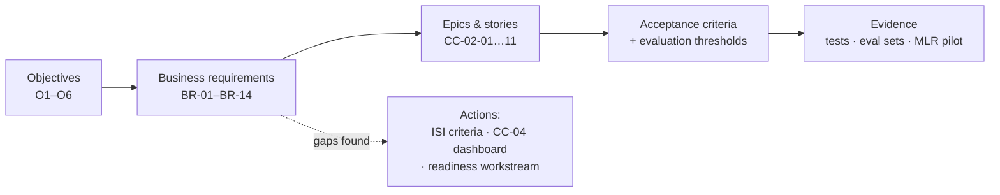

# Business Requirements Document: Content Composer R1

> A BRD states **what the business needs and why**, in business language. The epics, stories and specs elsewhere in this repo describe **how** it gets built. Section 9 traces every requirement to the work that delivers it, and shows the gaps that tracing found.

## 1. Document control

| Field | Value |
|---|---|
| Version | 1.0, for sign-off |
| Author | Kenneth Hwang (TPM/BA) |
| Business owner | Director, Marketing Content Operations |
| Related | [Program charter](../01-program-setup/program-charter.md) · [Epic CC-02](../04-requirements/epic-to-stories.md) · [Agent spec](../06-agent-spec/agent-functional-spec.md) · [Integration map](../07-integrations/integration-map.md) |

| Version | Date | Change |
|---|---|---|
| 0.1 | 2027-01-20 | First draft from stakeholder interviews |
| 0.5 | 2027-01-29 | Compliance review: business rules BRU-01 to BRU-06 added |
| 1.0 | 2027-02-05 | Traceability check added; 3 gaps raised (section 9). Business readiness and AI-disclosure requirements added after MLR and Marketing Ops review |

> **Living document.** The master copy lives in Confluence (`10 Product & Requirements`). Each business requirement is a Jira issue linked to the epics and stories that deliver it, so traceability comes from those links and stays current automatically. The matrix in section 9 is a snapshot of that view for sign-off.

## 2. Executive summary

US Commercial Marketing needs to get compliant HCP promotional content to MLR review faster, with fewer rejections, without weakening human accountability for what gets published. Release 1 introduces **Content Composer**, an AI drafting assistant that builds first drafts **only** from approved claims, checks them automatically, and hands a complete package to the existing MLR process in Veeva PromoMats. Every approval stays with a named person.

## 3. Business problem

| Today | Impact |
|---|---|
| Drafting goes through several agency rounds over email | Weeks from brief to MLR submission; agency cost on routine assets |
| Claims are copied from PDFs by hand, and wording drifts | The leading cause of MLR "revise and resubmit" decisions |
| References are attached to the MLR package by hand | Rejections for missing references; reviewer time spent on rework |
| MLR status lives in Veeva, task status in Workfront | Marketers chase status by hand |

See the [as-is / to-be workflow](../05-process/as-is-to-be.md) for the full current process and pain points P1–P5.

## 4. Business objectives

From the charter. Targets are hypotheses until the baseline is measured.

| ID | Objective | Measure | Pilot target |
|---|---|---|---|
| O1 | Faster time to MLR submission | Median days, brief "Ready" → submitted | 30–50% reduction |
| O2 | Higher first-pass MLR approval | Claim/reference-related rejections | 50% fewer |
| O3 | No loss of human control | AI content published without MLR approval | 0 (hard gate) |
| O4 | Trustworthy AI output | Groundedness · harmful drafts released (eval sets) | 100% · 0 |
| O5 | Reusable platform | Services reused by Module 2 | No rebuild |
| O6 | Adoption | Pilot-brand HCP emails started in Composer | ≥ 60% |

## 5. Scope

| In scope (R1) | Out of scope (R1) |
|---|---|
| One brand, US market, English | Other brands, markets and languages (R2 localization) |
| HCP email and web banner copy | Patient-facing content |
| Briefs from Workfront; images from AEM Assets | AI-generated images |
| Submission to MLR in Veeva PromoMats | Any automatic publishing; automated hand-off to AJO |
| Audit trail and quality measurement | Testing and personalization (Target / Optimizely) |

## 6. Users

| User | Needs from Composer | Key concern |
|---|---|---|
| **Brand marketer** | A usable first draft fast; one-step MLR submission; status in Workfront | "Can I trust it, and will it save me time?" |
| **MLR reviewer** (Medical, Legal, Regulatory) | Complete packages with every claim referenced | "Will AI drafts create more review work?" |
| **Compliance lead** | Control over guardrail rules; evidence the AI is behaving | "Can we prove what the AI did?" |
| **Marketing Ops / Workfront admin** | Briefs in a consistent structure | "Does this fit our workflow?" |
| **Global Marketing Excellence** | Brand standards applied; reusable for other markets later | "Will this scale globally?" |

## 7. Business requirements

Priority uses MoSCoW: **M**ust · **S**hould · **C**ould.

| ID | The business needs… | Rationale | Priority | Objective |
|---|---|---|---|---|
| BR-01 | Marketers to get a complete first draft of an HCP email or banner from a structured brief | Removes agency rounds for routine assets | M | O1 |
| BR-02 | Drafts to use **only** approved, current claims, worded exactly as approved, each linked to its references | Main cause of MLR rejections | M | O2, O4 |
| BR-03 | Every draft to carry the brand's current Important Safety Information (fair balance) | Regulatory requirement for promotional content | M | O2, O3 |
| BR-04 | Prohibited, off-label or unsupported statements to be stopped before a person sees the draft | Protects reviewers' time and the company | M | O2, O4 |
| BR-05 | A named person to approve every draft before MLR, and MLR to approve before any use | Accountability stays with people | M | O3 |
| BR-06 | Marketers to submit a complete MLR package (draft, images, references, claim annotations) in one step | Removes manual packaging and missing references | M | O1, O2 |
| BR-07 | MLR decisions and comments to appear on the Workfront task | One place to see status | S | O1, O6 |
| BR-08 | Image suggestions limited to approved, rights-cleared brand assets | Avoids rights violations | S | O1 |
| BR-09 | A complete, tamper-proof record of how each draft was produced and approved | Audit and inspection readiness | M | O3, O4 |
| BR-10 | Any change to the AI to be proven not to reduce compliance before release | Quality can't silently degrade | M | O4 |
| BR-11 | Leadership to see cycle time, first-pass approval and adoption against baseline | Proves the business case | M | O1, O2, O6 |
| BR-12 | Core services (claims retrieval, guardrails, evaluation, audit) built so other brands and modules can reuse them | Avoids rebuilding for Module 2 | S | O5 |
| BR-13 | **Business readiness:** marketers trained before pilot; MLR procedure updated for AI-assisted content; a support channel and 4-week hypercare after launch | Adoption depends on people and process, not just the tool | M | O6, O3 |
| BR-14 | MLR reviewers to see that a draft was **AI-assisted**, and which claims and sources it drew on | Reviewers need to know what they're reviewing; supports trust and audit | M | O3, O4 |

## 8. Business rules

Set by Compliance. They apply whatever the implementation, built or bought.

| ID | Rule |
|---|---|
| BRU-01 | A claim may appear only if its status is Approved and its expiry date is after the planned in-market date |
| BRU-02 | Claim text is never paraphrased in R1 |
| BRU-03 | The brand's current ISI is always included and never edited by AI |
| BRU-04 | Only the brief owner can approve a draft for MLR submission |
| BRU-05 | Nothing is published automatically. Use requires MLR approval in PromoMats |
| BRU-06 | No patient data in briefs, prompts or outputs |
| BRU-07 | Every AI-assisted piece submitted to MLR is labeled as AI-assisted, with the model and prompt version recorded |

## 9. Traceability matrix

Each business requirement traced to the stories that deliver it and the evidence that proves it. **Tracing exposed 3 gaps**, now raised as actions.

| BR | Delivered by | Verified by | Status |
|---|---|---|---|
| BR-01 | CC-02-01, CC-02-03 | Story AC; usefulness metric on eval set | ✅ Covered |
| BR-02 | CC-02-02, CC-02-03 · agent spec §4–5 (claim slots) | Groundedness and fidelity = 100% on eval set | ✅ Covered |
| BR-03 | Agent spec §4 (ISI always retrieved), §7 (ISI check) | — | ⚠️ **Gap:** no story has an acceptance criterion for ISI. **Action:** add AC "ISI present and unchanged" to CC-02-03 and CC-02-05 (owner: BA, by 2027-02-10) |
| BR-04 | CC-02-05 | Red-team set: 0 harmful drafts released | ✅ Covered |
| BR-05 | CC-02-06, CC-02-08 · HITL 1–3 | Story AC (only the owner can submit) | ✅ Covered |
| BR-06 | CC-02-08 · integration map §3 | Story AC; MLR pilot on 10 briefs | ✅ Covered (dependent on D-02) |
| BR-07 | CC-02-09 | Story AC | ✅ Covered |
| BR-08 | CC-02-04 | Story AC | ✅ Covered (I-03 data gap) |
| BR-09 | CC-02-10 | Story AC; audit export reviewed by Compliance | ✅ Covered |
| BR-10 | CC-02-11 | Release gate log | ✅ Covered |
| BR-11 | — | — | ⚠️ **Gap:** no epic delivers the metrics dashboard. **Action:** create epic CC-04 "Pilot metrics dashboard" (owner: PO + TPM, by 2027-02-12) |
| BR-12 | Platform epics PLT-01 (retrieval), guardrail and audit services | Module 2 reuse review | 🔵 Partly in R1; full reuse validated in R2 |
| BR-13 | — | — | ⚠️ **Gap:** no workstream owns training, MLR procedure updates or hypercare. **Action:** add a Business Readiness workstream to the charter, owned by the PO with Marketing Ops and MLR (by 2027-02-12) |
| BR-14 | CC-02-08 (AI-assisted label + source list on the PromoMats document) · CC-02-10 | Story AC; MLR pilot reviewer feedback | ✅ Covered |

## 10. Assumptions, constraints and dependencies

Tracked live in the [RAID log](../02-tracking/raid-log.csv). The ones that most affect these requirements:

| Ref | Item | Requirements affected |
|---|---|---|
| A-01 | Claims library is current and complete | BR-02 |
| R-04 / D-02 | No PromoMats sandbox yet | BR-06, BR-07 |
| I-01 | No baseline cycle-time data | BR-11 |
| I-03 | Image rights metadata incomplete | BR-08 |
| R-10 | Vendor-native AI may change what gets built | BR-01, BR-04, BR-12 (see [vendor assessment](../08-assessment/vendor-assessment.md)) |

## 11. Sign-off

| Role | Name | Decision | Date |
|---|---|---|---|
| Executive sponsor | VP, US Commercial Marketing | | |
| Business owner | Director, Marketing Content Operations | | |
| Compliance | Compliance Lead | | |
| DSML | DSML Lead | | |
| Digital Technology | DT Integration Lead | | |
